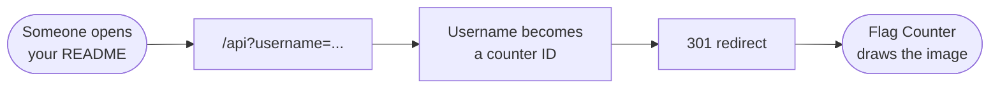

<div align="center">


# GitHub Visitor Counter

### See where your README visitors come from.

Add one line to your README. Get a live image of your visitors' country flags.

<a href="https://github-visitor-counter-tau.vercel.app/dashboard"></a> <a href="https://github-visitor-counter-tau.vercel.app"></a> <a href="https://github-visitor-counter-tau.vercel.app/api-help"></a> <a href="docs/overview.md"></a>

</div>

<br>

<div align="center">
<a href="https://github-visitor-counter-tau.vercel.app/dashboard"></a>

<sub>This is the counter itself, live, for <a href="https://github.com/ChanMeng666">@ChanMeng666</a>.</sub>
</div>

<br>

## Try it

Paste this into your README and replace `YOUR_USERNAME` with your GitHub username:

```markdown

```

No account is needed. A new counter starts from zero and fills up as people visit.

<br>

<div align="center">


<sub><code>&theme=github_dark&columns=4&maxflags=12</code></sub>

<br>


<sub><code>&showlabels=true&maxflags=6</code></sub>

<br>


<sub><code>&displayMode=miniCounter&miniDisplay=pageviews</code></sub>

</div>

<br>

The image at the top is `&displayMode=flagMap&mapSize=medium`. To pick options by eye, use the [dashboard](https://github-visitor-counter-tau.vercel.app/dashboard): it previews the counter and writes the line for you.

## How it works



The counting and the image come from [Flag Counter](https://flagcounter.com). This project gives you the one-line URL, the themes and the dashboard. Responses are cached for one hour.

## For your agent

This page is all a person needs. Every parameter, display mode and theme is in the docs: clone the repo and point your coding agent at [`docs/overview.md`](docs/overview.md) and [`CLAUDE.md`](CLAUDE.md).

```bash
git clone https://github.com/ChanMeng666/github-visitor-counter.git
```

<sub>[Full overview](docs/overview.md) · [Changelog](CHANGELOG.md) · [Contributing](CONTRIBUTING.md) · [Security](SECURITY.md) · [Support](SUPPORT.md) · [MIT](LICENSE)</sub>

<sub>Built by [Chan Meng](https://github.com/ChanMeng666).</sub>
